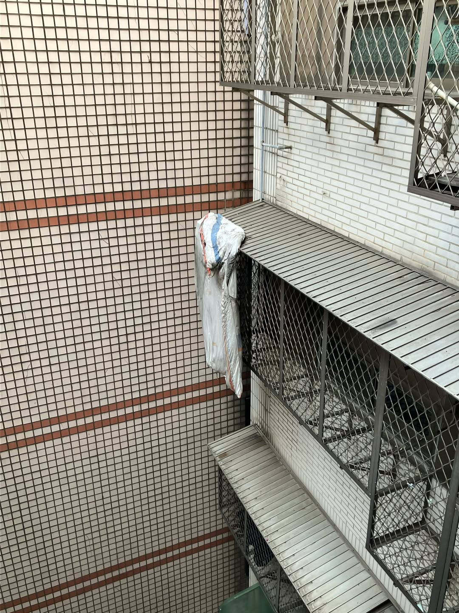

<h1 align="center">被被觀察日記</h1>

<p align="center">一條卡在屋簷上的被子，從 Day 1 開始的照片紀錄。</p>

<p align="center">
  <a href="https://littlesurvival.github.io/beibei/">
    
  </a>
</p>

<p align="center">
  
</p>

## 關於這份紀錄

原貼主是 Threads 上的 **芳宜**。照片來自她的每日紀錄，網站把照片整理成可播放的縮時和時間軸。每張照片都附有原文連結。 [Threads @fangyi_0923](https://www.threads.com/@fangyi_0923)

## 本機開發與建置

```sh
npm ci
npm run dev
npm run check
npm run build
```
